

&nbsp;
&nbsp;
&nbsp;

 

At PayPal I build the LLM services that help support teams reason about merchant
disputes: retrieval over years of resolved cases, grounded generation on top of it,
and the unglamorous pipeline work that makes both trustworthy. Outside work I ship
my own products end to end, from the first prototype to the signed installer, the
store listing and the DNS record.


 


<a href="https://dialdo.com"></a>
<a href="https://reporun.app"></a>
<a href="https://www.remotewindow.app"></a>
<a href="https://trailmails.com"></a>
<a href="https://gitpixelpush.com"></a>
<a href="https://apps.apple.com/us/app/relay-job-outreach/id6816765463"></a>
<a href="https://github.com/mananshah2254/OutreachOS"></a>
<a href="https://github.com/mananshah2254/airbridge-spatial-file-sharing"></a>

<b>Links, downloads and source</b>

 

| Product | What makes it interesting | Links |
|:--|:--|:--|
| **DialDo** | Twilio line, then a managed gateway, then an outbound WebSocket to your Mac. Provider keys never touch the device. Caller allowlist, a spoken PIN, and risk-labeled tools that confirm side effects out loud. Signed and notarized. | [site](https://dialdo.com) · [downloads](https://github.com/mananshah2254/dialdo-downloads/releases/latest) |
| **Repo Run** | Parses manifests across ecosystems, diffs required runtimes against the machine, and shows an explicit command plan before installing anything. Developer ID signed and notarized for Apple silicon and Intel. Windows preview. | [site](https://reporun.app) · [source](https://github.com/mananshah2254/repo-run) · [downloads](https://github.com/mananshah2254/repo-run-downloads/releases) |
| **Remote Window** | A native Swift host captures a single window with its audio and streams it over WebRTC. Viewers install nothing, every viewer is approved on the Mac, sessions expire on a timer, and touch input maps back onto the window. | [site](https://www.remotewindow.app) |
| **TrailMail** | Resolves company, then domain, then address pattern with a self-scored confidence, and sends through Gmail with a send-only scope. No server ever holds your data. | [site](https://trailmails.com) · [web store](https://chromewebstore.google.com/detail/bgmdpfdhgaignpljdpkmneeggbiolkce) · [source](https://github.com/mananshah2254/trailmail) |
| **GitPixelPush** | A browser-side engine that writes dated commits through the Git Data API. One small Cloudflare Worker for OAuth, nothing stored anywhere. | [site](https://gitpixelpush.com) · [source](https://github.com/mananshah2254/gitpixelpush) |
| **Relay** | Native SwiftUI app on the App Store, with a Share Extension and a dependency-free Node service. Review or automatic mode, daily caps, minimum spacing between sends. | [App Store](https://apps.apple.com/us/app/relay-job-outreach/id6816765463) · [source](https://github.com/mananshah2254/relay-ios) |
| **OutreachOS** | Drives the Voyager API directly rather than clicking the DOM, the only approach that survives a redesign. Per-action caps, warm-up, working hours and jitter. | [source](https://github.com/mananshah2254/OutreachOS) |
| **AirBridge** | A Watch gesture recognized with Core Motion triggers an encrypted Mac-to-iPhone transfer on the local network. A prototype, and its README says exactly what is untested. | [source](https://github.com/mananshah2254/airbridge-spatial-file-sharing) |

<b>Also on the workbench</b>

 

| | What it is |
|:--|:--|
| [**The portfolio**](https://mananshah2254.github.io/) | The bay in the banner above, in 3D. A physically based sky, an ocean shader with a procedural normal map and a batched coastline, flown from golden hour to dusk as you scroll. No 3D assets, no framework, no build step. [source](https://github.com/mananshah2254/mananshah2254.github.io) |
| **Email Research Engine** | The inference backend that started TrailMail. Resolves a company name to its real domain, mines public pages for example addresses, infers the organization's address pattern and scores its own confidence. One paid lookup per company, never per person. |
| **Agentic Voice System** | A proof of concept for an enterprise prospect: LLM reasoning, webhooks and CRM-style data handoffs, with conversation logic that survives multi-step tasks. The pattern underneath it became DialDo. |
| [**pixel-canvas**](https://github.com/mananshah2254/pixel-canvas) | My contribution graph, used as a canvas. Backdated empty commits, drawn with GitPixelPush. Yes, the graph below is on purpose. |

 



Regenerated daily by a GitHub Action in this repo. No third-party stats service, nothing to rate-limit or go down.

 



 



Text version

 

| | | |
|:--|:--|:--|
| **PayPal** | Software Engineer, AI and LLM platform | Apr 2025 to present |
| **Illinois Institute of Technology** | MS, Computer Science | Aug 2023 to May 2025 |
| **Duck Creek Technologies** | Software Engineer, enterprise insurance platforms | Mar 2021 to Jul 2023 |

 


<picture>
  <source media="(prefers-color-scheme: dark)" srcset="https://raw.githubusercontent.com/mananshah2254/mananshah2254/output/snake-dark.svg" />
  <source media="(prefers-color-scheme: light)" srcset="https://raw.githubusercontent.com/mananshah2254/mananshah2254/output/snake-light.svg" />
  
</picture>

The pixel art on my graph was painted with GitPixelPush. This snake, redrawn daily, eats it.

<a href="mailto:mananshah03691@gmail.com"></a>

<a href="https://mananshah2254.github.io/">mananshah2254.github.io</a> · <a href="https://www.linkedin.com/in/mananshah2254/">LinkedIn</a> · <a href="mailto:mananshah03691@gmail.com">mananshah03691@gmail.com</a>

