 

  

At PayPal I build the LLM services that help support teams reason about merchant
disputes: retrieval over years of resolved cases, grounded generation on top of it,
and the unglamorous pipeline work that makes both trustworthy. Nights and weekends
I ship my own products end to end, from the first prototype to the signed installer,
the store listing and the DNS record.

## Shipped

Things that are live, that strangers use, and that I maintain. Every card links to the product.

<b>Links, downloads and source</b>

 

| Product | What makes it interesting | Links |
|:--|:--|:--|
| **DialDo** | Twilio line → managed gateway → outbound WebSocket to your Mac. Provider keys never touch the device; caller allowlist, scrypt-hashed spoken PIN, risk-labeled tools that confirm side effects out loud. Signed and notarized. | [site](https://dialdo.com) · [source](https://github.com/mananshah2254/dialdo) · [downloads](https://github.com/mananshah2254/dialdo-downloads/releases/latest) |
| **Repo Run** | Parses manifests across ecosystems, diffs required runtimes against the machine, and shows an explicit command plan before installing anything. Developer ID signed and notarized for Apple silicon and Intel; Windows preview. | [site](https://reporun.app) · [source](https://github.com/mananshah2254/repo-run) · [downloads](https://github.com/mananshah2254/repo-run-downloads/releases) |
| **TrailMail** | Resolves company → domain → address pattern with a self-scored confidence, then sends through Gmail with a send-only scope. No server ever holds your data. | [site](https://trailmails.com) · [web store](https://chromewebstore.google.com/detail/bgmdpfdhgaignpljdpkmneeggbiolkce) · [source](https://github.com/mananshah2254/trailmail) |
| **GitPixelPush** | A browser-side engine that writes dated commits through the Git Data API. One ~100 line Cloudflare Worker for OAuth, nothing stored anywhere. | [site](https://gitpixelpush.com) · [source](https://github.com/mananshah2254/gitpixelpush) |
| **OutreachOS** | Drives the Voyager API directly rather than clicking the DOM, the only approach that survives a redesign. Per-action caps, warm-up, working hours and jitter. | [source](https://github.com/mananshah2254/OutreachOS) |
| **Relay for iOS** | SwiftUI app with a Share Extension and a dependency-free Node service. Two lanes: email goes out up front while the slow lookup finishes in the background. | [source](https://github.com/mananshah2254/relay-ios) |

<b>Also on the workbench</b>

 

| | What it is |
|:--|:--|
| **Email Research Engine** | The inference backend under TrailMail. Resolves a company name to its real domain, mines public pages for example addresses, infers the organization's address pattern and scores its own confidence. One paid lookup per company, never per person. |
| **Agentic Voice System** | Production-grade POC for an enterprise prospect: LLM reasoning, webhooks and CRM-style data handoffs, with conversation logic that survives multi-step tasks. The pattern underneath it became DialDo. |
| [**pixel-canvas**](https://github.com/mananshah2254/pixel-canvas) | My contribution graph, used as a canvas. Backdated empty commits, drawn with GitPixelPush. Yes, the graph below is on purpose. |

## Live from the workbench

Regenerated daily by a GitHub Action in this repo. No third-party stats service, nothing to rate-limit or go down.

## The stack

 

  

## Where I have been

Text version

| | | |
|:--|:--|:--|
| **PayPal** | Software Engineer, AI and LLM platform | Apr 2025 — present |
| **Illinois Institute of Technology** | MS, Computer Science | Aug 2023 — May 2025 |
| **Duck Creek Technologies** | Software Engineer, enterprise insurance platforms | Mar 2021 — Jul 2023 |

## The graph, eaten

<picture>
  <source media="(prefers-color-scheme: dark)" srcset="https://raw.githubusercontent.com/mananshah2254/mananshah2254/output/snake-dark.svg" />
  <source media="(prefers-color-scheme: light)" srcset="https://raw.githubusercontent.com/mananshah2254/mananshah2254/output/snake-light.svg" />
  
</picture>

The pixel art on my graph was painted with GitPixelPush. This snake, redrawn daily, eats it.

  

<i>Ambiguous problem in, working system out.</i> · <a href="https://mananshah2254.github.io/">mananshah2254.github.io</a>

